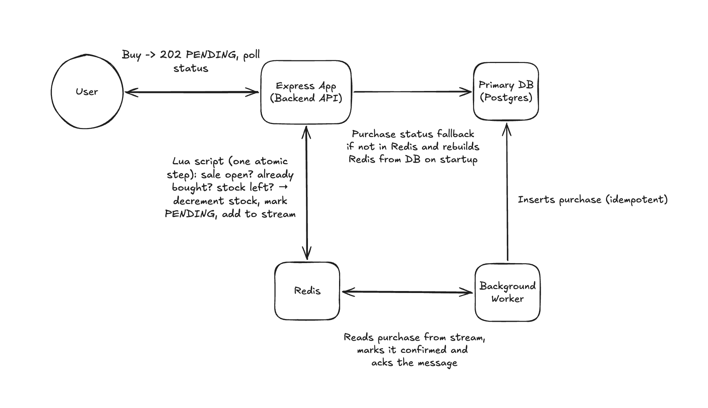

# Flash Sale

A flash-sale system for a single product with limited stock. It is built to stay
**correct under a burst of concurrent buyers**: it never oversells, a user can buy
at most once, and it only sells inside the sale window. It also lays out how the
design would scale.

- One product, limited stock, one purchase per user (identified by a username or email)
- The sale runs only within a configured start/end window
- Users can check the sale status and the status of their purchase

> This project was built using Matt Pocock's [/grill-me](https://www.aihero.dev/skills-grill-me) skill to agree on every design decision with the agent before writing any code.

---

## System Diagram



---

## Quick start

Requirements: Node 22+, pnpm, Docker.

```bash
pnpm install
cp .env.example .env
pnpm infra:up                      # Postgres + Redis in Docker
pnpm sale:setup --stock 100 --start-in 30s --duration 5m
pnpm dev                           # API :3000, worker, web :5173
```

Open http://localhost:5173.

| Command | What it does |
| --- | --- |
| `pnpm infra:up` / `pnpm infra:down` | Start / stop Postgres and Redis |
| `pnpm dev` | Run the API, worker and web app with live reload |
| `pnpm sale:setup [flags]` | Start a fresh sale. **Wipes all purchases.** |
| `pnpm test` | Unit tests plus integration tests (needs `infra:up`) |
| `pnpm stress` | k6 burst against the running app, then verify the end state (needs `dev`) |
| `pnpm typecheck` | Type-check every package |
| `pnpm db:migrate` | Apply migrations (the API also does this on start) |

### Configuring a sale

```bash
pnpm sale:setup --stock 100 --start-in 30s --duration 5m      # relative window
pnpm sale:setup --start 2026-10-23T09:00:00Z --end 2026-10-23T09:15:00Z
pnpm sale:setup --name "Retro Console" --price 199.99 --image /console.jpg
```

Defaults: 100 units, starting in 10s, lasting 5 minutes, "Limited Edition Sneakers" at $129.00.

---

## How a purchase works

```
Browser ──POST /api/purchase──▶ API ──EVALSHA──▶ Redis Lua gate ──XADD──▶ purchase stream
   ▲                             │                                            │
   │ 202 PENDING                 │                                            ▼
   └──── poll GET /api/purchase/:userId ◀── Redis (status) ◀── Worker ──▶ Postgres
```

1. **Normalise the identifier.** `" Alice@Example.com "` becomes `alice@example.com`, so one person is one buyer. It must be 3–64 characters from `a-z 0-9 . _ @ + -`.
2. **Run the gate.** One Lua script ([`attempt-purchase.lua`](packages/core/src/redis/scripts/attempt-purchase.lua)) runs atomically inside Redis:
   - Is the sale open? It checks against **Redis' clock**, so every API instance agrees.
   - Has this user already bought? (`HEXISTS`)
   - Is there stock left?
   - If all three pass: `DECR` stock, record the user as `PENDING`, and `XADD` the purchase to the stream.
3. **Reply 202 Accepted.** The unit is secured; persisting it happens asynchronously.
4. **Persist in the worker.** A separate process reads the stream through a consumer group, inserts the row into Postgres (`ON CONFLICT DO NOTHING`), then marks the purchase `CONFIRMED` and acknowledges the message in one `MULTI`.
5. **Poll for the outcome.** The browser polls the status until it is `CONFIRMED` or `FAILED`. Status reads Redis first and falls back to Postgres.

### API

| Endpoint | Responses |
| --- | --- |
| `GET /api/sale` | `200` with state (`UPCOMING`, `ACTIVE`, `SOLD_OUT`, `ENDED`), remaining and total stock, window, product, `serverTime` · `404 NO_SALE` |
| `POST /api/purchase` `{ "userId": "..." }` | `202 PENDING` · `409 ALREADY_PURCHASED` · `410 SOLD_OUT` · `403 SALE_NOT_ACTIVE` · `400 INVALID_USER_ID` |
| `GET /api/purchase/:userId` | `200` with `PENDING`, `CONFIRMED` or `FAILED` · `404` with `NOT_FOUND` |
| `GET /healthz` | `200` if Redis and Postgres respond, otherwise `503` with details |

---

## Design decisions

### Redis is the gate; Postgres is the record

A flash sale is a burst of writes against **one hot row**: the stock count. Putting
that row in Postgres means every request queues on the same row lock. Redis does
the check-and-decrement in memory, one script at a time, at tens of thousands of
operations per second on a single core.

Postgres stays the durable source of truth. Its `UNIQUE (sale_id, user_id)`
constraint is a second line of defence for the one-per-user rule, and it is also
what makes worker retries safe.

### The gate and the enqueue are one atomic step

The Lua script both claims the unit and puts the purchase on the queue. Nothing
runs between those two actions, so no crash can leave a unit claimed without a
queued purchase, or a queued purchase without a claimed unit. This is the main
reason for **Redis Streams over an external queue** such as SQS, RabbitMQ or BullMQ.
With those, the "claim" and the "send" are two separate calls, and closing the
gap between them needs an outbox table or a reconciliation sweeper.

### Why a queue when only winners reach Postgres?

Only accepted purchases are queued, so at most *stock* messages ever reach the
database, however many people click. The queue isn't there to absorb traffic.
It's there to **decouple**: the buy request never waits on Postgres, a database
hiccup becomes a retry rather than a user-facing error, and the API and the
writers scale independently.

### Delivery guarantees

| Situation | What happens |
| --- | --- |
| Worker crashes mid-message | The message stays unacknowledged. Another worker takes it over with `XAUTOCLAIM` after 30s. |
| Same message processed twice | `INSERT … ON CONFLICT DO NOTHING` makes the second insert a no-op. |
| Postgres keeps failing | 5 attempts with backoff, then [`dead-letter-purchase.lua`](packages/core/src/redis/scripts/dead-letter-purchase.lua) atomically marks the purchase `FAILED`, **returns the unit to stock**, records it on the dead-letter stream and acknowledges the message. |
| Sale reset while messages are in flight | The dead-letter script sees the sale ID has changed and only acknowledges the message. Old messages never touch the new sale's stock. |

The result is at-least-once delivery with idempotent processing, which is
effectively exactly-once.

### What if Redis dies?

- **Persistence.** Redis runs with **AOF** `appendfsync everysec`, so a crash can lose up to about one second of writes. That is the trade-off for throughput (`always` would fsync on every write).
- **Rebuild on start.** If the sale keys are missing, the API rebuilds Redis from Postgres ([`rebuild-redis.ts`](packages/core/src/sale/rebuild-redis.ts)): the sale, the remaining stock (total minus confirmed) and every settled buyer. So the one-per-user rule still holds after data loss.
- **What can be lost.** Purchases that were still `PENDING` (accepted but not yet persisted) when Redis lost data. Those units return to stock.
- **In production:** run a replicated, managed Redis (e.g. ElastiCache with Multi-AZ, or MemoryDB, whose transaction log removes the loss window). Also set `REDIS_MIN_REPLICA_ACKS=1`: the API then runs `WAIT` after the gate so a purchase is on a replica before the user gets their 202.

### Other choices

- **One clock.** Both the purchase gate and `GET /api/sale` use Redis `TIME`, never the API server's clock. The status a user sees always matches what the gate will decide, and `serverTime` in the response is that same clock.
- **Sale status never touches Postgres.** `GET /api/sale` is polled by every open browser, so it reads only Redis.
- **On-time status changes.** The page polls every 2s for stock, and also schedules a refresh for the exact moment the sale opens or closes. It measures that moment against `serverTime`, not the browser's clock, so the badge and **Buy now** button change within about 60 ms of the boundary, even on a device with a wrong clock.
- **Cluster-ready keys.** Every key shares the `{flash-sale}` hash tag, so they land in one Redis Cluster slot, which a multi-key Lua script requires.
- **Stateless API.** Any number of instances can run behind a load balancer; all coordination happens in Redis.
- **No ORM.** Plain SQL migrations and queries keep the data model visible.

---

## Scaling further

| Bottleneck | Next step |
| --- | --- |
| API CPU | Run more API instances. They hold no state. |
| Worker throughput | Run more workers in the same consumer group. Redis spreads messages across them. |
| Single hot stock key (~50–100k ops/s) | Split stock across N counters (N keys) on different shards, or put a **waiting room** in front that admits users at a controlled rate. |
| Bots and abuse | Real authentication, rate limiting per user/IP, CAPTCHA, and the waiting room above. |
| Status polling load | Server-sent events or WebSockets, or a CDN with a short cache for `GET /api/sale`. |

### Out of scope (deliberately)

- **Payment.** Here a purchase is final once accepted. A real system would place a reservation that **expires** (e.g. 10 minutes to pay) and return the unit to stock if it isn't paid.
- **Authentication.** The identifier is trust-based. Anyone can type any name.
- **Rate limiting and an admin UI.** Sales are configured through the CLI.

---

## Testing

```bash
pnpm infra:up
pnpm test
```

**Unit tests** (`packages/shared`): working out the sale state (including the edges of the half-open window), normalising and validating identifiers, and parsing durations.

**Integration tests** (`packages/core/test`) run against the real Postgres and Redis, with no mocks, using a separate `flash_sale_test` database and Redis DB 1:

- Gate rules: sale window, duplicate purchases, sold out
- **500 concurrent buyers across 10 connections for 10 units → exactly 10 accepted**
- 50 simultaneous clicks from one user → exactly 1 accepted
- Worker persists purchases, idempotent redelivery, takeover of a crashed worker's messages
- Dead-letter path: `FAILED`, stock returned, message acknowledged
- Stale message after a sale reset
- Status lookup with Postgres fallback
- Redis rebuild from Postgres

### Stress test

```bash
pnpm dev          # in one terminal
pnpm stress       # in another
```

The stress test resets the sale to 100 units, then runs k6 (in Docker) with 200
virtual users sending 6,000 requests: 5,000 distinct buyers plus 1,000 repeat
clicks. After the burst it waits for the worker to drain the queue and checks:

| Check | Expected |
| --- | --- |
| Confirmed purchases in Postgres | 100 |
| Confirmed purchases in Redis | 100 |
| Failed purchases | 0 |
| Users with more than one purchase | 0 |
| Remaining stock | 0 |
| Dead-lettered messages | 0 |

Sample run on a laptop (one API process, one worker): **~5,700 requests/s,
p95 31 ms, p99 99 ms**. Exactly 100 requests were accepted, 100 were rejected as
duplicates and 5,800 as sold out, and all checks passed.

---

## Project layout

```
apps/
  api/        Express API: routes, error handling, startup (migrate + rebuild)
  worker/     Worker process entry point
  web/        React + Vite product page
packages/
  shared/     Code shared by browser and server: API types, identifier rules, sale state
  core/       Server logic: Redis gate and Lua scripts, consumer, repositories, migrations
scripts/      sale:setup, db:migrate, stress (with end-state verification)
stress/       k6 scenario
docs/         Architecture diagram
```
